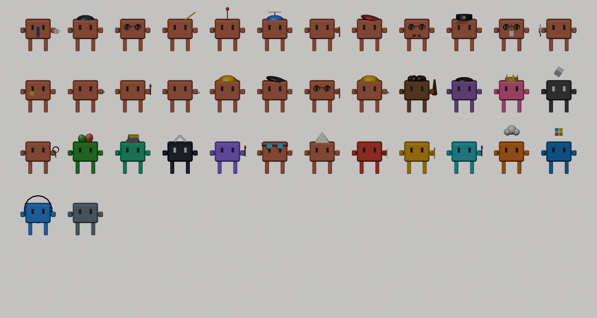

# Clawd Mifflin

A live 3D office where everything in your Claude Code setup works as a character. Each plugin, MCP server, built-in tool and your memory has its own desk. When Claude calls a tool, that character walks back to its desk and types. When nothing is happening, they get coffee, play ping pong, gossip at the water cooler or nap on the couch.



## Run it live

```sh
node server.mjs
# open http://127.0.0.1:4717
```

No `npm install` needed. The server only listens on 127.0.0.1. It reads:

| What | From |
| --- | --- |
| Plugins (enabled / disabled, MCP servers, skills) | `~/.claude/settings.json`, `~/.claude/plugins/` |
| User MCP servers | `~/.claude.json` |
| Memory files | `~/.claude/projects/*/memory/` |
| Who is working right now | the last 2 MB of each session transcript changed today (MYT), plus Claude Code hooks if installed |
| HQ (private) | `private/hq.json`, plus `git log` of the HQ's repo |
| Session and weekly usage bars | the same endpoint `/usage` uses, with your Claude Code login. The token never leaves the server process. |

The online version (GitHub Pages) opens behind a password gate. The demo password shows a snapshot of the roster with simulated work, marked **DEMO**; the snapshot is sealed with that password (`public/state.enc`, PBKDF2 + AES-GCM) and holds no transcript events, no project or memory file names and nothing from the HQ. Refresh it with `npm run snapshot` (the password comes from `demoPassword` in `~/.config/clawd-mifflin/config.json`). The live password shows the live view instead.

## The building

The office is built from a Blender home kit (`public/models/kit.glb`): cream plaster walls with tan caps on a 0.5 m grid, room-tinted floor tiles, a lawn board with soil sides, picket fence, round trees and the kit's furniture (desks with PCs, office chairs, sofas, water dispenser, coffee machine, fridge, aircons, wall lights, cars). The back walls stand full height with windows; the rest are cut away low, like a dollhouse.

The floor plan follows Dunder Mifflin Scranton: the entrance opens on reception, Claude's office (with the "World's Best Boss" mug) and the conference room line the west side, the bullpen fills the middle, and the annex (break room, records, HR) runs along the north. Phone booths sit at the edge of the bullpen, close to the desks, and the MCP wing has a private office per server down its own corridor.

Every repeated piece is one `InstancedMesh` per material, so the whole building costs ~120 draw calls however many desks it has, and the floor uses 12-triangle tiles instead of the kit's bevelled ones (half the scene's triangles). Lighting is the Home Map's warm hemisphere plus one shadowed sun; after dark, soft light pools appear under the ceiling lights and the bulbs glow instead of adding real lights.

## Live online (password)

The GitHub Pages site shows the real office when you unlock it with the password:

```
your Mac: server.mjs ──POST every change (≥ once a minute)──▶ Cloudflare Worker + Durable Object
                                                                        │ GET with password
                                                  GitHub Pages site ◀───┘
```

- `worker/` is the relay (`npx wrangler deploy` from that folder). Its secrets are `PUSH_TOKEN` (the Mac) and `VIEW_PASSWORD` (viewers), compared in constant time; only the Pages site and the local server may call it from a browser (CORS).
- The Mac's server pushes when it finds `~/.config/clawd-mifflin/config.json` with `pushUrl` and `pushToken` (kept out of the repo, mode 600).
- `scripts/install-agent.sh` keeps the server running at login with launchd (`--remove` to undo). Log: `~/Library/Logs/clawd-mifflin.log`.
- The site remembers the password in that browser. If the Mac sleeps, the badge turns to **OFFLINE · seen 5m ago** and everyone goes idle.
- Without a password the site shows only the gate. The demo password opens the sealed demo, without the HQ.

To change the password: `printf 'new-password' | npx wrangler secret put VIEW_PASSWORD` in `worker/`, then update `viewPassword` in the config file for your own reference.

## The HQ (private)

A second building for your own project, next door. It is described in `private/hq.json`, which git ignores, so its name, features and code paths never reach the public repo or the demo: it only appears on the Mac's own page and in the unlocked live view. Each feature gets an office and a member of staff who works when a session touches its files; there are vacant "now hiring" rooms, an HR wing (plugins, MCP servers and repos, weekly), a mail cart for new commits, a weekly heat map and links to the code.

## Spotify account

Without an account the Spotify card follows the Spotify app on this Mac (AppleScript). Connect your account to see what you play on any device (phone, speaker, web player), with album art and progress; controls need Spotify Premium.

1. At https://developer.spotify.com/dashboard create an app (Web API). Redirect URI: `http://127.0.0.1:4717/api/spotify/callback`.
2. Put its Client ID in `~/.config/clawd-mifflin/config.json` as `"spotifyClientId": "..."` and restart the server (`launchctl kickstart -k gui/$(id -u)/dev.clawd-mifflin`).
3. On the Mac's page open ♫ Spotify → **Connect your Spotify account**.

The sign-in uses PKCE (no client secret). Tokens stay in `~/.config/clawd-mifflin/spotify.json` (mode 600); **Disconnect Spotify** deletes them.

## Daily digest (Telegram)

Make a bot with @BotFather, send it a message, then add to `~/.config/clawd-mifflin/config.json`:

```json
"telegram": { "token": "<bot token>", "chat": "<your chat id>" }, "digestHour": 21
```

At that hour (MYT) the server sends the day's summary: calls, failures, sessions, tokens, usage, Dundies, commits and red builds. **Send today's digest** in the 📊 Report panel (on the Mac's page) sends one straight away.

## A second Mac (branch office)

On the other Mac, run this server with the same `pushUrl` and `pushToken` and a `"machine": "work-laptop"` in its config. Its sessions appear on a glass floor above the terminals in the live view; on the main Mac's page too when `viewPassword` is in that Mac's config. A branch that stops pushing is marked offline, and drops off after a day.

## Instant updates (Claude Code hooks)

```sh
node scripts/install-hooks.mjs            # adds async hooks to ~/.claude/settings.json (backup kept beside it)
node scripts/install-hooks.mjs --remove   # takes them out again
```

Each hook POSTs its event to `127.0.0.1:4717/api/hook` in the background, with a 2 s timeout, so Claude never waits. The office then reacts at once instead of a few seconds later, and it can tell when a session is stuck on a permission prompt, which the transcript never shows. Without the hooks everything still works from the transcripts.

## Install it as an app, full screen, phones sideways

- **Install app** in the ribbon: Chrome, Edge and Samsung Internet install it straight away; on iPhone and iPad it explains Share → Add to Home Screen, in Safari on the Mac File → Add to Dock. Installed, it opens without the browser bars (full screen on Android), and the last copy opens offline.
- **⛶ Full screen** toggles full screen (iPhone Safari has none for pages: use the Home Screen app).
- **Phones held sideways** (touch, landscape, under 520 px tall: Galaxy S23 Ultra, iPhone 15 Pro...) get a compact layout: the brand and usage shrink to small cards, and round buttons bottom right hold the rest: ⛶ full screen, **i** activity and details, ♫ Spotify as a small bubble, ☰ the ribbon (which closes again after you pick a view). Tablets such as the Xiaomi Pad 6 and every desktop keep the full layout.

## The careers fair

The careers fair (and the HQ's HR wing) interview three kinds of candidate every week: **plugins** (from the marketplaces, scored on each booth's keywords and categories), **MCP servers** and **repos** (GitHub search, most stars first, for the terms in `cast.json` → `fair`). The searches run once a week through the `gh` CLI (its token stays in gh) and are cached in `~/.config/clawd-mifflin/hr-search.json`.

## HR: weekly picks

HR interviews eight plugins every week (ISO week, MYT). Candidates come from the plugin marketplaces Claude Code has already downloaded, minus what you have installed, scored against your week: file types you edited, commands you ran (git, gh, wrangler, expo...), the packages your projects depend on, and the tools you leaned on. Click a candidate for why it was picked and the `/plugin install` line.

## How the office works

- **Who goes where.** Each active Claude Code session is a Claude: the newest has the manager's desk, others take the spare desks in Claude's office (or the conference table). Built-in tools and Anthropic's own plugins sit in bullpen pods; plugins from other companies share the co-working table.
- **Interns.** Every running subagent is an intern, hired by the session that started it. It walks from that Claude to the conference table, works there, hands the result back and leaves.
- **Failures.** A tool call that comes back with an error makes its character slump and flash red with the tool name; the feed marks it ✗. Every MCP server gets its own office in the MCP wing. Memory lives in the archive. Hooks sit at reception. HR interviews candidate plugins and MCP servers each week.
- **Colours.** Anthropic-made characters are Claude orange. Others use their company's colour (Playwright is Microsoft green, Context7 is Upstash teal, and so on).
- **Working.** The character glows faintly in its company colour. A tool call with no result yet, or one that finished less than 6 seconds ago, puts its character at the desk. The PC shows scrolling code and a bubble shows the tool name. In the MCP wing the office floor lights up too. Claude works whenever any session answered in the last 20 seconds.
- **Idle.** Coffee, vending machine, fridge, couch, table, ping pong (the ball only flies when both ends are taken), water cooler, copier, the window, or visiting someone's desk. Claude visits people a lot and calls meetings in the conference room.
- **Day and night.** The sky, sun and office lights follow Malaysia / Singapore time (UTC+8). After 21:30 most idle staff sleep at their desks. Drag the time slider to preview any hour.
- **Usage limit.** When the 5-hour session reaches 100%, idle staff all head to the break room.
- **Hand-offs.** When a tool call starts, a glowing sheet flies from Claude to that character's desk. When it finishes, the result flies back.
- **Employee of the Month.** The board next to the water cooler ranks characters by tool calls since midnight MYT.
- **City view.** Kuala Lumpur sits outside the north windows: Petronas Twin Towers, KL Tower and office blocks whose windows light up at night.
- **Refresh.** The ↻ Refresh button fetches the latest activity and asks the server for fresh usage numbers (at most every 10 seconds).
- **Live switch.** Turns live updates off: the page stops fetching, and on the Mac's own page the server also stops pushing and stops reading usage. The office keeps going on its own. (Watching never spends Claude usage: the usage numbers come from a status endpoint, not from running the model.)
- **Moving around.** Drag to pan, right-drag or two fingers to turn, wheel or pinch to zoom, arrow keys pan.
- **Same-file clash.** When two sessions edit the same file within 10 minutes, their Claudes leave their terminal desks, meet in the annex hallway and argue it out, and you get an alert: one of them is about to overwrite the other.
- **Fire drill.** Once weekly usage passes 80%, the alarm sounds (once per weekly reset), the lights flash red, everyone not at work files out to the assembly point on the front lawn, and the usage card stays red. Add `?drill` to the URL to preview.
- **BIM lab.** West of the gym, next to the nap pods. On the Mac's own page the newest `.ifc` in your home folder (or `ifcPath` in the config) is loaded with web-ifc and turns slowly on the lab table; the file never leaves the Mac. Everyone else sees a sample tower.
- **Nap pods.** Six capsules beside the gym, where most of the night shift sleeps.
- **Time-lapse.** ⏺ Time-lapse plays today's replay and saves it as a video (MP4 or WebM, depending on the browser). Name tags and bubbles are page elements, so they are not in the video.
- **Careers.** Click anyone: their calls per day over the last 30 days, their best day and their Dundies.
- **Branch offices.** Another Mac running this server (with `machine` set) pushes to the same relay and shows up as a glass floor above the terminals, its sessions at the desks.
- **Rec wing.** West of the main office, through doors in the break room, conference room and Claude's office: a game room (pool, foosball, arcade cabinets, darts), a gym (treadmills, weights, yoga mats) and a chill zone with beanbags. Staff only sit at their desks to work; idle time goes to the break room and the rec wing, and at night most nap on sofas and beanbags.
- **Careers fair.** The south end of the rec wing has three booths of six candidates each, picked weekly: **Terminal** (everyday Claude Code), **Design** and **BIM** (Revit, IFC, AutoCAD, Rhino, Blender, Speckle...).
- **Pros and cons.** Every suggestion says why it might or might not suit you. For repos and MCP servers: stars, last update, licence, who keeps it, Windows-only desktop apps, API keys. For plugins: official or community-made, what it fits, MCP context cost, accounts needed.
- **Session badges.** Each terminal desk shows the session's model, effort and permission mode. A session in plan mode works at the whiteboard.
- **Failures explained.** Click a ✗ in the feed (or the character) to see the start of the error and the command or file it was working on.
- **Build board.** Over the terminal desks: the latest GitHub Actions run of each workflow in both repos (and EAS builds when eas-cli is installed). A failed run sends its character (Bash, Website or Crash Reports) running to its desk; a green deploy fires confetti in that building's lobby.
- **Payroll board.** Tokens per session today, with the share that came from cache.
- **Heat map.** HQ offices glow with how many lines their files changed in the last 7 days.
- **KL weather.** Real weather from Open-Meteo (no key): rain, clouds, thunderstorms with lightning, and haze when PM2.5 is high. Add `?weather=storm`, `rain`, `haze` or `clear` to the URL to preview.
- **Weekly report.** 📊 Report: this week's calls by day, busiest staff, failures, commits per HQ feature, files edited and the Dundies, with Copy as text.
- **Office cat.** Wanders the office, naps on the busiest keyboard, follows your mouse for a while when you hover over it, meows when clicked.
- **Terminals.** A glass annex between the two buildings has five desks, T1 to T5, one per Claude Code session (terminal) that is running. A session's Claude sits at its desk and works, screen scrolling, while that session is busy. The boss Claude stays in its office and works whenever any of them does.
- **Where to get it.** Click any character: plugins, MCP servers, connectors, candidates and repos show a **Get it** link (the official page or GitHub repo) with a Copy button for sharing. HQ feature offices link to their code.
- **Spotify.** ♫ Spotify in the dock shows what's playing on the Mac and, on the Mac's own page, has previous / play-pause / next. It uses AppleScript, so macOS asks once to let the server control Spotify. While music plays, idle staff dance and a ♪ sign hangs over the break room TV. The online page shows what's playing but can't control it.
- **Waiting for you.** When a session finishes its turn, or needs your OK on a permission prompt (hooks only), its Claude walks to the office door and waves, with a bubble saying which. Turn on **Alerts** for a desktop notification as well.
- **Context window.** Each session desk has a paper stack that grows as the session's context fills up (white, then yellow past 65%, red past 85%). When the session compacts, the pile goes through the shredder next to the desk.
- **Mail cart.** A new commit in the HQ's repo drives in from the gate to every feature office whose files it touched, and that character reads the commit message out.
- **Replay.** ▶ Replay plays today's tool calls in 90 seconds, with the clock and the sky following along.
- **The Dundies.** A board next to Employee of the Month gives out Most Tool Calls, Butterfingers (most failures), Night Owl (calls between 22:00 and 06:00) and Longest Nap (longest gap between calls). At midnight MYT the day's winners walk up to the board to collect their trophy.
- **Sound.** Off by default. When on: typing, the coffee machine, ping pong, a buzz on failures, the shredder, the mail cart horn, a chime when Claude is waiting, and a fanfare at the Dundies. Everything is synthesised in the browser, no audio files.
- **Walking.** A* on a 0.5 m grid with path smoothing. Walkers push apart when they get too close.

## Characters

`blender/build_cast.py` builds every character from `public/cast.json` and exports `public/models/cast.glb`:

```sh
npm run models
```

To add a character, add an entry to `characters` (or `candidates`) in `public/cast.json` and rebuild. Plugins or MCP servers that are not in the file still get hired: they use a generic mascot with a generated colour.

## Test

```sh
npm test
```
